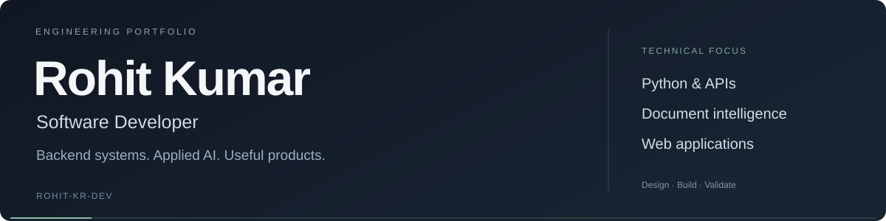

<picture>
  <source media="(max-width: 600px)" srcset="./assets/profile/engineering-mobile.svg" />
  
</picture>

[Portfolio](https://bespoke-showcase-gen.lovable.app/) &nbsp;·&nbsp; [LinkedIn](https://www.linkedin.com/in/rohit-kr-dev/) &nbsp;·&nbsp; [Email](mailto:rohitkumarpbegur@gmail.com) &nbsp;·&nbsp; [Repositories](https://github.com/rohit-kr-dev?tab=repositories)

I build **Python backend systems, document-processing applications, and web interfaces**. My focus is making data useful: extracting it, exposing it through APIs, and connecting it to workflows people can use.

Currently a **Software Developer at Polymetalz Pvt. Ltd.**

## Current work

At **Polymetalz**, I work on backend systems and AI-powered internal tools. My work includes a private CRM dashboard for **data visualization, user management, and workflow tracking**, using Python, Flask, Firebase, and MySQL.

## Selected engineering work

### Resume Extractor PRO & ATS Analytics
**Document processing · Python · Flask · NLP · Docker**

A resume-processing application that turns PDF, DOCX, and TXT files into structured candidate information, compares resumes with job descriptions, and presents recruiter analytics.

- **Architecture:** Separate modules for document extraction, parsing, ATS analysis, and data export.
- **Data workflow:** Candidate filtering, job-description matching, and CSV, JSON, and Excel outputs.
- **Delivery:** Flask API and web interface, with Docker-based setup and automated tests.

[Repository](https://github.com/rohit-kr-dev/Resume_Eextractor) · [Architecture & setup](https://github.com/rohit-kr-dev/Resume_Eextractor#readme)

### RaithaMarga
**Marketplace contribution · React · Firebase · State management**

Contributions to a **Kannada/English agricultural marketplace** connecting farmers and buyers.

- **Contribution:** Home-page navigation, responsive layouts, typed quantity controls, and transparent platform-fee summaries.
- **State & reliability:** Shared guest/buyer cart state, account-specific persistence, stock-bound quantities, and persisted checkout idempotency keys.
- **Validation:** Unit tests and browser checks for guest-to-buyer handoff, live totals, cross-tab synchronization, and existing negotiation states.

[Repository](https://github.com/RaithaMarga/RaithaMarga) · [Contribution branch](https://github.com/RaithaMarga/RaithaMarga/tree/fix/home-navigation-cart) · [Implementation commit](https://github.com/RaithaMarga/RaithaMarga/commit/6d52866)

### Voice2Script Studio
**Speech processing · Python · Whisper · Gemini · Streamlit**

An audio-to-screenplay application that connects speech transcription with AI-assisted script generation and export.

- **Pipeline:** Audio ingestion and normalization → Whisper transcription → screenplay generation → Fountain, TXT, or JSON export.
- **Design choice:** Transcription and generation are separate steps, allowing users to change genre or tone without repeating speech transcription.

[Repository](https://github.com/rohit-kr-dev/voice2screenplay) · [Pipeline & design notes](https://github.com/rohit-kr-dev/voice2screenplay#readme)

### Stonecore Capital
**Web development · React · JavaScript · Tailwind CSS**

A responsive property-discovery website with searchable listings, location and budget filters, and interactive property cards. Focused on reusable UI components and consistent behavior across desktop and mobile layouts.

[Repository](https://github.com/rohit-kr-dev/real-estate-react-app)

## Technical toolkit

| Area | Technologies & work |
| :--- | :--- |
| **Backend** | Python, Flask, REST APIs |
| **Data & storage** | SQL, MySQL, Firebase, Pandas |
| **Applied AI** | NLP, document extraction, resume analysis, Whisper, Gemini |
| **Web** | React, JavaScript, HTML, CSS, Tailwind CSS, Streamlit |
| **Cloud & tooling** | AWS, Docker, Git, Linux |

Additional tools

Java, Power BI, and Tableau.

## Experience

| Role | Organization | Period |
| :--- | :--- | :--- |
| **Software Developer** | **Polymetalz Pvt. Ltd.** | **Aug 2025 – Present** |
| Data Science Intern | Gyaanova | Mar 2025 – Jun 2025 |
| AWS DevOps Intern | NSDC | Sep 2024 – Nov 2024 |
| Full Stack Development Intern | Grow4Tech Pvt. Ltd. | May 2023 – Jun 2023 |

Certifications & continued learning

- **Data Analytics Job Simulation** — Deloitte
- **Hands-On Microsoft Azure Cloud** — Infosys Springboard
- **Introduction to Cloud Computing** — Infosys Springboard
- **Spoken Tutorials: C, Java, HTML, and Python** — IIT Bombay

## Contact

Interested in **backend, applied AI, and data engineering opportunities**, and collaboration on practical software projects.

[rohitkumarpbegur@gmail.com](mailto:rohitkumarpbegur@gmail.com) · [LinkedIn](https://www.linkedin.com/in/rohit-kr-dev/) · [Portfolio](https://bespoke-showcase-gen.lovable.app/)
