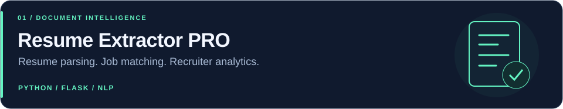
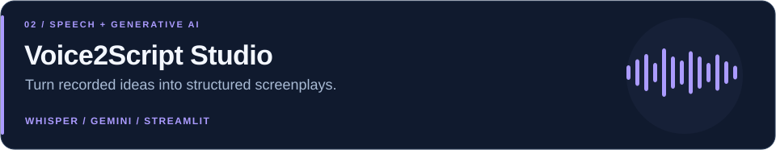
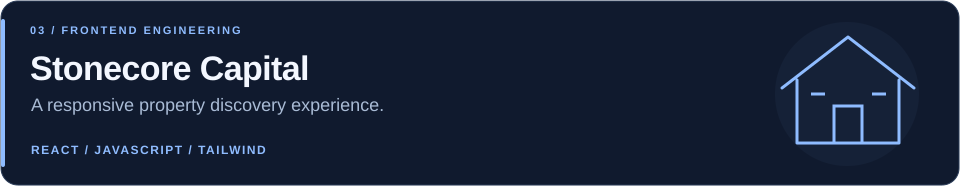
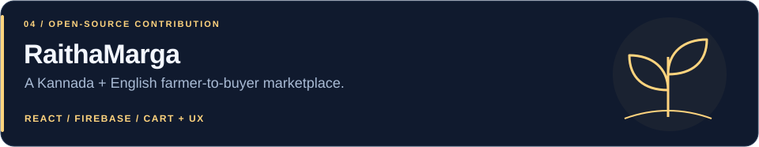

  <picture>
    <source media="(max-width: 600px)" srcset="./assets/profile/hero-mobile.svg" />
    
  </picture>

  
  
  

  <a href="#selected-work">Selected work</a> &nbsp; / &nbsp;
  <a href="#toolkit">Toolkit</a> &nbsp; / &nbsp;
  <a href="#experience">Experience</a> &nbsp; / &nbsp;
  <a href="#lets-build-something-useful">Get in touch</a>

## What I build

I'm **Rohit Kumar**, a **Software Developer at Polymetalz Pvt. Ltd.** I work on Python backend systems, AI-powered internal tools, and web applications.

I enjoy connecting the whole workflow: **data in → useful processing → clear APIs → an interface people can use.** My projects span resume analysis, speech-to-screenplay tools, business dashboards, and marketplace experiences.

> **Open to opportunities:** Backend Development · AI/ML Engineering · Data Engineering

## Selected work

Extract structured information from **PDF, DOCX, and TXT resumes**, compare candidates with job descriptions, and explore recruiter analytics. Includes candidate filtering and **CSV, JSON, and Excel exports**.

[Explore the code →](https://github.com/rohit-kr-dev/Resume_Eextractor)

Combine **Whisper speech transcription** with **Gemini-assisted screenplay generation**. A Streamlit interface connects audio uploads, genre and tone controls, and Fountain/TXT/JSON exports.

[Explore the code →](https://github.com/rohit-kr-dev/voice2screenplay)

A responsive **React property-discovery website** with searchable listings, location and budget filters, and interactive property cards for desktop and mobile.

[Explore the code →](https://github.com/rohit-kr-dev/real-estate-react-app)

Contributions to a **Kannada/English farmer-to-buyer marketplace**: cleaner navigation, mobile layouts, typed quantity controls, guest-to-buyer cart synchronization, and transparent platform-fee summaries.

[Explore the project →](https://github.com/RaithaMarga/RaithaMarga) · [View my navigation and cart work →](https://github.com/RaithaMarga/RaithaMarga/tree/fix/home-navigation-cart)

## Toolkit

**Backend & databases**

  
  
  
  
  

**AI & data**

  
  
  
  
  
  

**Web & languages**

  
  
  
  
  

**Cloud & developer tools**

  
  
  
  

## Experience

### Software Developer · Polymetalz Pvt. Ltd.
**Aug 2025 – Present**

Building backend systems and AI-powered internal tools. My work includes a private CRM dashboard for **data visualization, user management, and workflow tracking**, using Python, Flask, Firebase, and MySQL.

| Earlier experience | Organization | Period |
| :--- | :--- | :--- |
| Data Science Intern | Gyaanova | Mar 2025 – Jun 2025 |
| AWS DevOps Intern | NSDC | Sep 2024 – Nov 2024 |
| Full Stack Development Intern | Grow4Tech Pvt. Ltd. | May 2023 – Jun 2023 |

<strong>Certifications & continuous learning</strong>

- **Data Analytics Job Simulation** — Deloitte
- **Hands-On Microsoft Azure Cloud** — Infosys Springboard
- **Introduction to Cloud Computing** — Infosys Springboard
- **Spoken Tutorials: C, Java, HTML, and Python** — IIT Bombay

---

## Let's build something useful

**Have a backend challenge, an AI workflow, or a product idea? Let's talk.**

[Email me](mailto:rohitkumarpbegur@gmail.com) · [Connect on LinkedIn](https://www.linkedin.com/in/rohit-kr-dev/) · [Visit my portfolio](https://bespoke-showcase-gen.lovable.app/)

Python backend · Applied AI · Thoughtful web experiences

